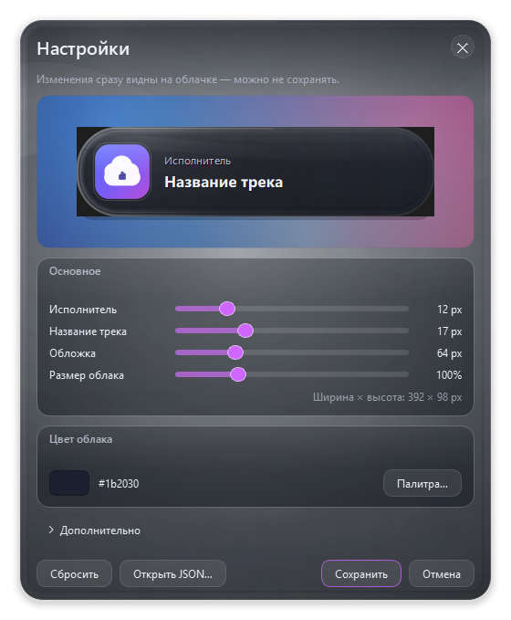

# Сейчас играет — стеклянное облачко для Windows

[](https://github.com/Aueueaueueaae/now-playing-widget/actions/workflows/ci.yml)
[](https://github.com/Aueueaueueaae/now-playing-widget/actions/workflows/build.yml)
[](LICENSE)

Маленький виджет в системном трее, который показывает текущий трек из Windows
Media Session (SMTC): обложку, исполнителя и название. Никакой консоли, главного
окна и облачных сервисов — только прозрачная карточка поверх рабочего стола.

**[Скачать последний релиз](https://github.com/Aueueaueueaae/now-playing-widget/releases/latest)** ·
**[Исходный код](https://github.com/Aueueaueueaae/now-playing-widget)** ·
Лицензия MIT

```
┌──────────────────────────────────────────┐
│  ▣  Исполнитель                          │
│     Название трека — очень длинное наз…  │
└──────────────────────────────────────────┘
```

## Что умеет

- Показывает обложку, исполнителя и название текущего трека.
- Работает с любым плеером, который отдаёт данные в Windows: Spotify, браузеры,
  Яндекс.Музыка, VK, foobar2000 с SMTC-плагином и т. п.
- Если обложки нет или плеер прислал свою стоковую заглушку, показывает
  виниловую пластинку (`assets/vinyl-record.png`). Картинку можно заменить своей.
- Логотипы браузеров (например, Chrome при воспроизведении из ВК Музыки) тоже
  распознаются и заменяются винилом.
- Стекло окрашивается только выбранным цветом — обложка не заливает облачко.
- Liquid-glass вид: прозрачная, но не «пустая» линза, тонкая преломляющая
  кромка, блики и сильное скругление облачка почти до капсулы.
- Облачко можно перетащить в любое место; позиция сохраняется между запусками.
- Плавно исчезает при паузе и возвращается при возобновлении.
- Не показывается, когда музыки нет.
- Автоматически уезжает за пределы рабочего стола в полноэкранной игре, чтобы
  не мешать, но остаётся видимым окном для OBS Window Capture.
- Глобальная горячая клавиша показа/скрытия (по умолчанию `Ctrl+Alt+Shift+M`).
- Автозапуск с Windows.
- Настройки мышкой в отдельном окне с живым превью. JSON нужен только
  продвинутым пользователям.
- Один экземпляр приложения, без сети и телеметрии.

## Безопасность и открытость

Проект создан так, чтобы его можно было проверить и собрать самостоятельно:

- исходный код полностью открыт, без обфускации и скрытых бинарников;
- приложение **не делает сетевых запросов**, не содержит телеметрии, рекламы и
  автообновлений;
- настройки и лог хранятся только в профиле пользователя;
- exe собирается публично в GitHub Actions из этого репозитория;
- к каждому релизу прилагается `SHA256SUMS.txt` для проверки архива.

```powershell
Get-FileHash .\NowPlayingWidget-*.zip -Algorithm SHA256
```

Exe не подписан коммерческим сертификатом, поэтому Windows может показать
SmartScreen. Это нормально для open-source проектов: можно нажать
«Подробнее → Выполнить в любом случае», запустить из исходников или собрать
exe самому. Подробнее — в [SECURITY.md](SECURITY.md).

## Быстрый старт для друзей

1. Распакуйте `NowPlayingWidget-1.6.0-win64.zip` в любую папку.
2. Запустите `NowPlayingWidget.exe`.
3. Включите музыку — облачко появится само.
4. Настройте вид через меню иконки в трее: **«Настройки…»**.

Windows может показать предупреждение SmartScreen, потому что exe не подписан
цифровой подписью. Нажмите **«Подробнее» → «Выполнить в любом случае»**.

Настройки и лог хранятся в профиле пользователя, а не рядом с exe, поэтому
перенос или обновление файла их не сбрасывает.

## Настройки мышкой



Меню иконки в трее → **«Настройки…»**. Окно выполнено в том же стиле liquid
glass: полупрозрачная тёмная панель с текстурой, мягкой тенью и толстой светлой
кромкой. Его можно перетаскивать за заголовок, закрыть крестиком или клавишей
Esc. Внутри — живое превью: облачко на рабочем столе меняется сразу, ещё до
нажатия «Сохранить». «Отмена» возвращает прежний вид.

На главном экране — четыре ползунка:

| Настройка | Что делает |
|---|---|
| **Исполнитель** | Размер шрифта исполнителя, 8–28 px. |
| **Название трека** | Размер шрифта названия, 11–32 px. |
| **Обложка** | Размер обложки и виниловой заглушки, 40–140 px. |
| **Размер облака** | Масштабирует всё облако вместе с обложкой, шрифтами и отступами, 20–160%. Рядом показан итоговый размер в пикселях. |

Ниже — **цвет облака**: кнопка-образец и «Палитра…» открывают обычный выбор
цвета Windows. Быстрых пресетов нет. Текст остаётся светлым на цветном стекле;
тёмным он становится только на почти белом нейтральном облачке.

Всё остальное спрятано под кнопкой **«Дополнительно»**: блик, мутность,
преломление и тонировка стекла, картинка-заглушка, задержка скрытия после
паузы, автозапуск, игровой режим, список исключений и горячая клавиша.

Кнопка **«Сбросить»** возвращает значения по умолчанию. Кнопка
**«Открыть JSON…»** открывает полный файл настроек — на случай, если нужно
что-то, чего нет в окне.

## Запуск из исходников

Требуется Windows 10/11 x64 и Python 3.13.

```powershell
git clone https://github.com/Aueueaueueaae/now-playing-widget.git
cd now-playing-widget
py -3.13 -m pip install -r requirements.txt
pyw -3.13 main.py
```

Если `py -3.13` недоступен, используйте полный путь к `python.exe` и
`pythonw.exe` вашей установки Python 3.13. Запускайте именно через
`pythonw.exe`, иначе рядом появится окно консоли.
Приложение живёт в трее. Клик по иконке или горячая клавиша скрывают и
показывают облачко.

## Сборка и упаковка

Всё автоматизировано скриптом `build.ps1`:

```powershell
cd now-playing-widget
py -3.13 -m pip install -r requirements-dev.txt
.\build.ps1
```

Скрипт:

1. проверяет Python, PyInstaller и наличие картинок в `assets`;
2. собирает один файл `dist\NowPlayingWidget.exe` (PyInstaller, `--onefile`,
   без консоли);
3. кладёт в `release\NowPlayingWidget\` готовый exe, README и краткую
   инструкцию;
4. создаёт архив `release\NowPlayingWidget-1.6.0-win64.zip` — его можно
   отправлять друзьям.

Полезные варианты:

```powershell
.\build.ps1 -SkipZip      # только exe
.\build.ps1 -SkipBuild    # только пересобрать архив из готового exe
.\build.ps1 -Python "D:\Python313\python.exe"
```

Внутрь exe попадает вся папка `assets`, поэтому иконка и виниловая пластинка
работают без дополнительных файлов рядом.

Релизные сборки также выполняются публично в GitHub Actions
(`.github/workflows/build.yml`). К архиву прилагается `SHA256SUMS.txt`.

## Файл настроек (для продвинутых)

```
%APPDATA%\NowPlayingWidget\settings.json
```

После сохранения файла приложение подхватывает изменения автоматически.
Окно настроек пишет в этот же файл.

| Параметр | По умолчанию | Описание |
|---|---|---|
| `font_size` | `17` | Размер названия трека, 11–32 px. |
| `artist_font_size` | `12` | Размер строки исполнителя, 8–28 px. |
| `cover_size` | `64` | Размер обложки и виниловой пластинки, 40–140 px. |
| `bubble_scale` | `1.0` | Размер облачка: 0.2–1.6. Масштабирует обложку, шрифты, отступы и размеры целиком. |
| `fallback_image` | `assets/vinyl-record.png` | Картинка для треков без обложки. Можно указать абсолютный путь. |
| `bubble_color` | `#1b2030` | Цвет облачка в формате `#RRGGBB`. |
| `glass_intensity` | `0.78` | Яркость бликов, 0.0–1.0. |
| `glass_frost` | `0.15` | Мутность: `0` — прозрачное стекло, `1` — матовое. |
| `glass_refraction` | `0.75` | Толщина и преломление кромки, 0.0–1.0. |
| `opacity` | `0.90` | Тонировка стекла, 0.3–1.0. |
| `pause_hide_delay_sec` | `3.0` | Через сколько секунд после паузы скрыть облачко. `0` — сразу. |
| `autostart` | `false` | Запуск вместе с Windows. |
| `hotkey` | `Ctrl+Alt+Shift+M` | Глобальная клавиша. Формат: `Ctrl+Alt+M`, `Win+Shift+F9`. |
| `detect_games` | `true` | Уводить ли облачко за экран в полноэкранных играх. |
| `ignore_fullscreen_processes` | `[]` | Процессы, которые не считать игрой: `["myapp.exe"]`. |
| `position` | `null` | Последняя позиция; сохраняется автоматически. |

Если JSON повреждён, виджет продолжает работать с настройками по умолчанию и
показывает уведомление. Исправьте файл и сохраните — изменения применятся.

## OBS

Добавьте источник **Window Capture / Захват окна** и выберите окно
`Now Playing Widget`.

Рекомендуется способ захвата **Windows 10 (1903 and up)** (Windows Graphics
Capture). В отличие от Display Capture, он захватывает само окно, даже когда
облачко уведено за пределы рабочего стола в игровом режиме.

> **Важно:** Display Capture (захват экрана/монитора) не увидит облачко в
> игровом режиме, потому что физически оно находится за границей рабочего стола.
> Это сделано намеренно, чтобы не мешать игре. Используйте Window Capture.

Если OBS не находит окно, проверьте, что виджет запущен и что в списке окон
выбран именно `Now Playing Widget`.

## Игровой режим

Раз в 0,8 секунды виджет проверяет активное окно. Если оно занимает весь монитор
и похоже на игру (безрамочное окно, эксклюзивный fullscreen или подтверждение от
оболочки Windows), облачко переносится далеко за левую границу виртуального
рабочего стола. Окно при этом не скрывается и продолжает обновляться — OBS
Window Capture видит актуальную карточку.

Браузеры, проводник, OBS, Discord, Zoom, Teams и подобные приложения в список
игр не попадают. Свои исключения можно добавить в
**«Дополнительно» → «Поведение»** или в `ignore_fullscreen_processes`.

После выхода из игры облачко возвращается на прежнее место.

## Горячая клавиша

По умолчанию `Ctrl+Alt+Shift+M`. Комбинация меняется в
**«Дополнительно» → «Горячая клавиша»**. Нужен хотя бы один модификатор
(`Ctrl`, `Alt`, `Shift`, `Win`) и
обычная клавиша. Поддерживаются `A–Z`, `0–9`, `F1–F24`, `Space`, `Enter`,
стрелки, `Home`, `End`, `PageUp`, `PageDown`, `Insert`, `Delete`,
`PrintScreen`.

Если комбинация занята другой программой, виджет сообщит об этом и оставит
прежнюю.

## Где лежат логи

```
%LOCALAPPDATA%\NowPlayingWidget\widget.log
```

Лог обновляется с ротацией (до 3 МБ). Если что-то пошло не так, пришлите
последние строки оттуда.

## Ограничения

- Нет эквалайзера, истории треков и интеграций со стриминговыми API.
- Защищённый DRM-контент некоторые плееры не отдают в SMTC — тогда виджет
  просто ждёт следующий трек.
- В эксклюзивном полноэкранном режиме некоторые игры могут перекрывать
  topmost-окна. Виджет всё равно уводится за экран, поэтому игре он не мешает.
- Display Capture не видит уведённое за экран облачко; используйте Window
  Capture.
- Windows 10/11 x64. macOS и Linux не поддерживаются.

## Структура проекта

```
main.py                       точка входа, логирование, single-instance
build.ps1                     сборка exe и zip для распространения
nowplaying/app.py             контроллер: трей, медиа, игра, настройки
nowplaying/bubble.py          окно облачка, анимации, перетаскивание
nowplaying/glass.py           общая отрисовка liquid glass и текстуры
nowplaying/app_icons.py       сравнение обложки с иконкой плеера
nowplaying/settings_dialog.py компактное окно настроек с живым превью
nowplaying/media.py           фоновый SMTC-воркер и обложки
nowplaying/game_detect.py     определение полноэкранных игр
nowplaying/config.py          JSON-настройки и их валидация
nowplaying/autostart.py       автозапуск через HKCU\...\Run
nowplaying/winutil.py         Win32: hotkey, topmost, геометрия экранов
nowplaying/icon.py            иконка, если нет assets/icon.ico
tools/                        визуальные и диагностические тесты
assets/icon.ico               иконка приложения
assets/icon.png               картинка для превью настроек
assets/vinyl-record.png       обложка-заглушка
docs/                         скриншоты для README
```

## Участие в разработке

См. [CONTRIBUTING.md](CONTRIBUTING.md). Ручные визуальные тесты находятся в
`tools/`, релизная сборка — в GitHub Actions.

## Лицензия

MIT. См. [LICENSE](LICENSE).
